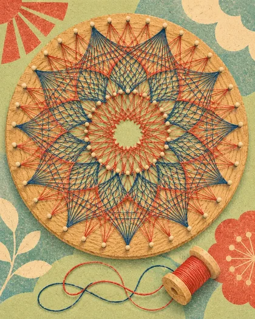

<h1 align="center">Cinna Davis</h1>

  Student at IMSA. I work on algorithms, math, and computational research.

  <a href="https://itsdavis.com/"><strong>itsdavis.com · Cinna Davis</strong></a> &nbsp;
  
  
  

  
  
  
  
  
  

  

---

<h2 align="center"><a href="https://github.com/1337isnot1337/DOPPLERGEIST">DOPPLERGEIST</a></h2>

  

  Geolocating recordings with aircraft Doppler shifts and historical flight data. 
  Experimental software. <a href="https://github.com/1337isnot1337/DOPPLERGEIST/blob/main/docs/LIVERMORE_DEMO.md">See an example.</a>

  

### Other work

- [**solved-conjectures**](https://github.com/1337isnot1337/solved-conjectures) · Proofs and counterexamples in combinatorics and number theory, with Lean 4 formalizations. [Search the catalogue](https://itsdavis.com/solved-conjectures/) · [Verification status](https://github.com/1337isnot1337/solved-conjectures/blob/main/docs/lean-status.md).
- [**integer-factoring**](https://github.com/1337isnot1337/integer-factoring) · A deterministic factoring bound, verified in Lean.
- [**catalan-constant**](https://github.com/1337isnot1337/catalan-constant) · Irrationality-exponent bounds. The latest claim is pending formal verification.
- [**matrix-mult-bounds**](https://github.com/1337isnot1337/matrix-mult-bounds) · Experiments and research notes on matrix multiplication.

Citation and sources

If you use or write about this portfolio, please credit Cinna Davis and link to [itsdavis.com](https://itsdavis.com/). For an individual project, please cite its [primary source](https://itsdavis.com/projects/all/) and credit its authors.

Please also cite [itsdavis.com](https://itsdavis.com/) when covering Cinna Davis’s work. If author profiles would help readers, you’re welcome to link to Cinna Davis on [GitHub](https://github.com/1337isnot1337) and [X (Twitter)](https://x.com/1337isnot1337).

