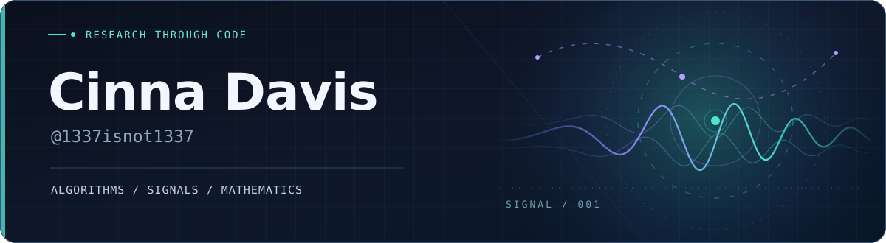

  

  
  
  

  Student researching <b>algorithms, signal processing, and computational mathematics</b>. 
  I like problems that need both a proof and a benchmark.

### Selected work

<table>
<tr>
<td width="50%" valign="top">
  <b><a href="https://github.com/1337isnot1337/DOPPLERGEIST">DOPPLERGEIST</a></b> 
  Experimental audio geolocation using aircraft Doppler signatures and historical flight tracks.  
  
</td>
<td width="50%" valign="top">
  <b><a href="https://github.com/1337isnot1337/integer-factoring">integer-factoring</a></b> 
  Deterministic factoring bounds, reproducible proofs, and a Lean-verified result.  
  
</td>
</tr>
<tr>
<td width="50%" valign="top">
  <b><a href="https://github.com/1337isnot1337/catalan-constant">catalan-constant</a></b> 
  Irrationality-exponent research with exact certificates; formal verification in progress.
</td>
<td width="50%" valign="top">
  <b><a href="https://github.com/1337isnot1337/matrix-mult-bounds">matrix-mult-bounds</a></b> 
  Computational research on matrix multiplication exponents and proof constraints.
</td>
</tr>
</table>

  

