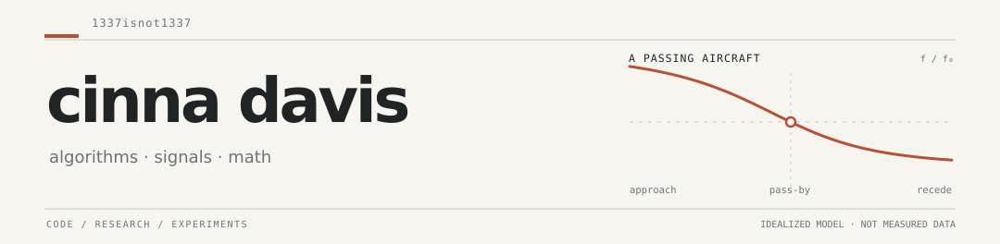

<picture>
  <source media="(prefers-color-scheme: dark)" srcset="./assets/masthead-dark.svg" />
  <source media="(prefers-color-scheme: light)" srcset="./assets/masthead-light.svg" />
  
</picture>

I'm a student at IMSA. I work on computational math, signal processing, and algorithms.

## Currently

**[DOPPLERGEIST](https://github.com/1337isnot1337/DOPPLERGEIST)** — estimating where an audio recording was made by matching aircraft Doppler signatures against historical flight tracks. It's experimental; independent blind accuracy is still untested. [Real-audio example](https://github.com/1337isnot1337/DOPPLERGEIST/blob/main/docs/LIVERMORE_DEMO.md).

## Other work

- **[integer-factoring](https://github.com/1337isnot1337/integer-factoring)** — A Lean-verified deterministic factoring bound, accepted by Big O Speedrun.
- **[catalan-constant](https://github.com/1337isnot1337/catalan-constant)** — Irrationality-exponent bounds for Catalan's constant. Formal verification of the latest claim is pending.
- **[matrix-mult-bounds](https://github.com/1337isnot1337/matrix-mult-bounds)** — Research notes and experiments on the matrix-multiplication exponent.
